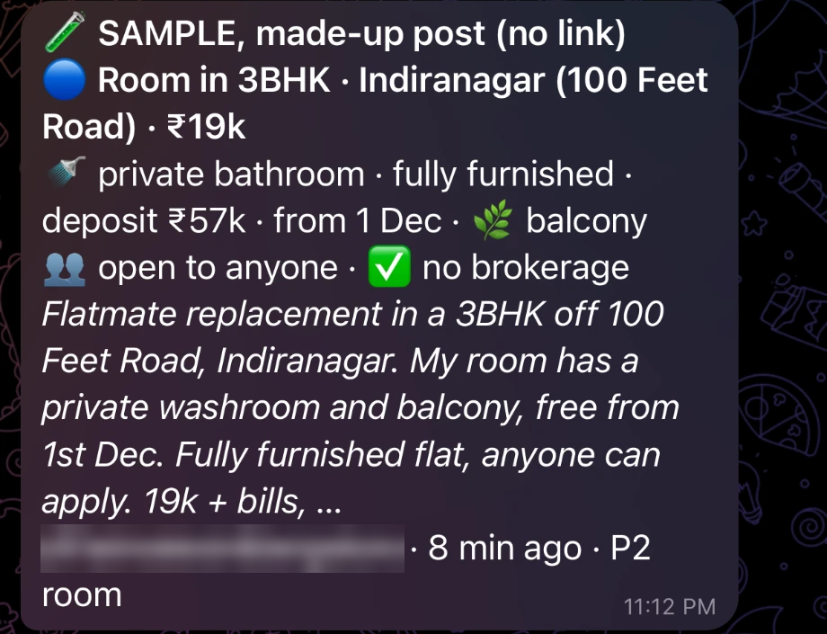
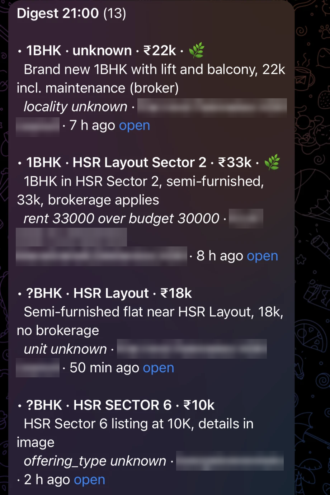
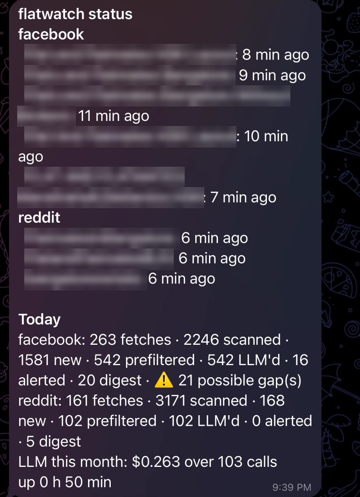
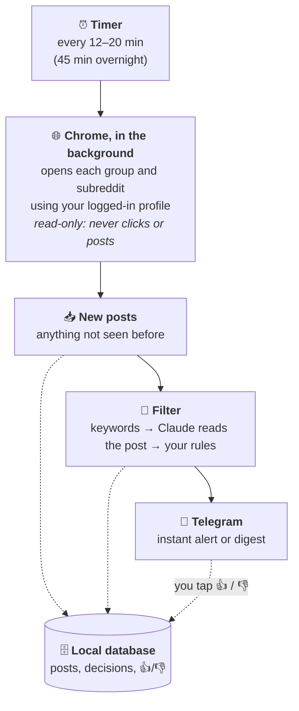
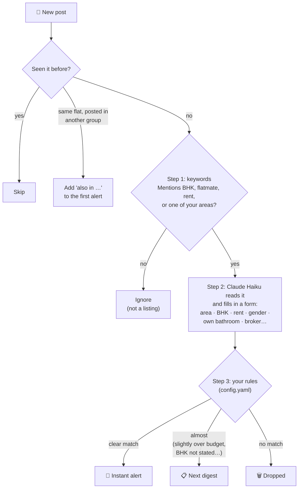
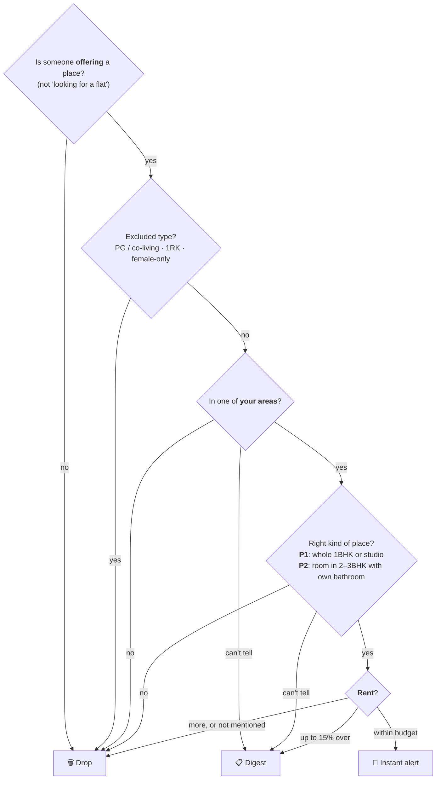
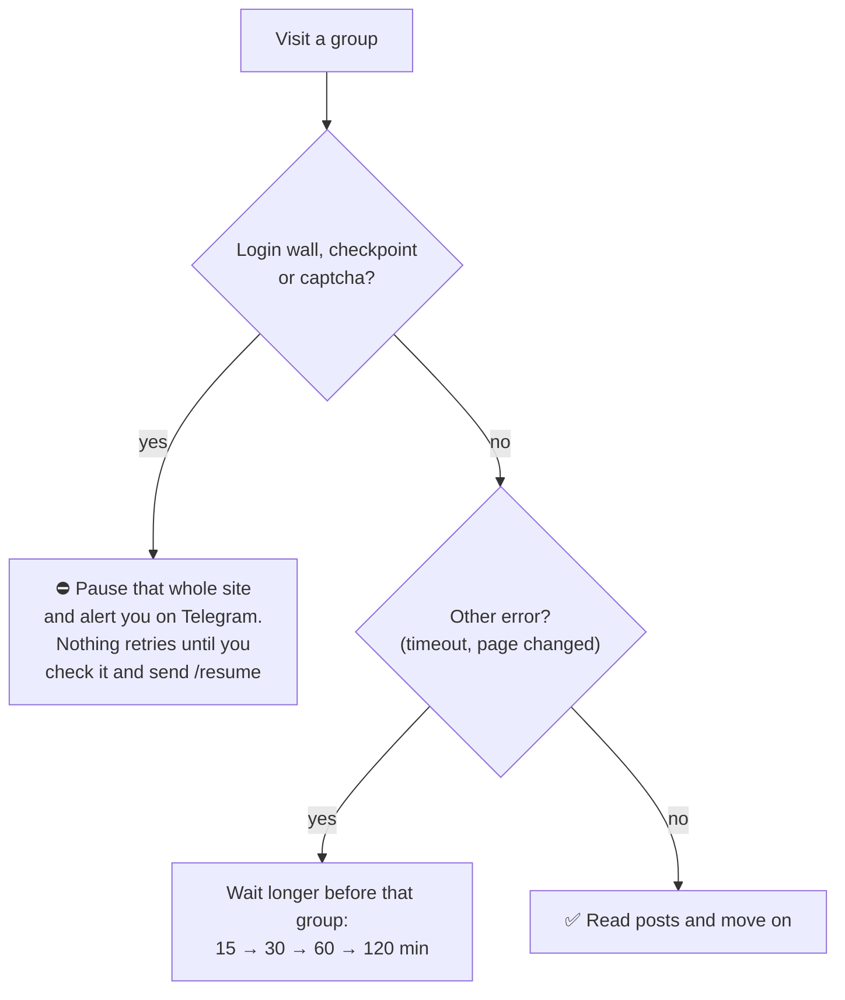

# flatwatch

Watches Facebook groups and subreddits for flat and flatmate listings, keeps the ones that match your criteria, and sends them to you on Telegram within about 15 minutes of being posted.

Built for Bangalore. The areas, budget and flat type are all set in a config file.

<table>
  <tr>
    <td align="center"><b>Instant alert</b></td>
    <td align="center"><b>Twice-daily digest</b></td>
    <td align="center"><b><code>/status</code> in Telegram</b></td>
  </tr>
  <tr>
    <td></td>
    <td></td>
    <td></td>
  </tr>
  <tr>
    <td>A clear match arrives within about 15 minutes, with the key facts on top. (This one is a made-up sample post.)</td>
    <td>Near-misses wait for the 9 am and 9 pm digest, each with the reason it wasn't an instant alert.</td>
    <td>When each group was last checked, plus today's counts and LLM spend.</td>
  </tr>
</table>

<sub>Group and subreddit names are blurred.</sub>

## How it works

### The big picture



In plain words, this is what happens every cycle:

1. **Wake up.** A timer fires every 12–20 minutes, slower at night. A small random delay is added so the visits don't look robotic.
2. **Open the groups.** A hidden Chrome window uses its own profile, which you logged into once by hand. It visits your Facebook groups and subreddits one by one, 20–60 seconds apart.
3. **Collect new posts.** On each page it scrolls until it has 15 posts or reaches the last post it saw before, whichever comes first, and never more than 5 scrolls. Posts it has already seen are skipped.
4. **Filter.** Cheap checks run first, then Claude Haiku reads only the posts that look like listings, then your rules from `config.yaml` decide (details below).
5. **Notify.** Clear matches go to Telegram straight away. "Almost" matches wait for the 9 am / 9 pm digest. Everything else is dropped quietly.
6. **Learn.** Your 👍 / 👎 taps are saved, so you can check later whether the rules need tuning.

### What happens to one post



Keywords are free and remove most of the noise, so Claude only sees posts that are probably listings. Its first two days, including a backtest, cost about $0.26 in LLM usage. If Claude is unreachable, a simple pattern check still catches obvious matches, and you get a message saying the bot is running in degraded mode.

### How the rules decide

The rules are a plain function you can read in `src/flatwatch/match.py`. The thresholds come from `config.yaml`. Each question is asked in order, and the first "no" stops the post.



### Staying safe on Facebook and Reddit



- **Read-only:** flatwatch only opens feed pages and scrolls. It never posts, comments, reacts, messages, joins groups or types a password. You log in by hand once.
- **Gentle:** one site at a time, pauses between groups, at most 5 scrolls per visit, and a slower pace overnight.
- **Watched:** if a source hasn't fetched successfully for an hour, you get one alert. Messages that fail to send (for example while the Wi-Fi is down) are queued and delivered later.

> Automated reading of Facebook may break Facebook's terms. Use your own account at your own risk.

## Requirements

- macOS with Google Chrome installed. Other systems can run `flatwatch run` under their own service manager.
- Python 3.12+ and [uv](https://docs.astral.sh/uv/).
- A Telegram bot token from [@BotFather](https://t.me/BotFather) and your chat id.
- For the LLM step, either:
  - a Claude subscription with the [Claude Code](https://claude.com/claude-code) CLI logged in (`claude auth login`), which is the default; or
  - an Anthropic API key (set `extract.backend: anthropic_api`).

## Install

```bash
uv tool install git+https://github.com/shivangkhajuria/flatwatch
```

To work on the code instead, clone it and run `uv sync`, then use `uv run flatwatch ...`.

## Setup

> **Setting it up with an AI assistant?** Give [`assistant_instructions.md`](assistant_instructions.md) to Claude (or another coding assistant). It walks the assistant through every step below, including when to stop and ask you about your criteria or have you log in, plus the safety rules it must keep and fixes for common problems. For example: *"Read assistant_instructions.md and set up flatwatch for me."*

```bash
flatwatch init                    # creates ~/.flatwatch/config.yaml and ~/.flatwatch/.env
```

1. **`~/.flatwatch/.env`:** your personal settings. This file is never committed.
   ```ini
   TELEGRAM_BOT_TOKEN=123456:ABC...
   TELEGRAM_CHAT_ID=123456789
   FLATWATCH_FACEBOOK_GROUPS=https://www.facebook.com/groups/1234567890/,https://www.facebook.com/groups/some-slug/
   FLATWATCH_SUBREDDITS=SomeSubreddit,AnotherOne
   ```
2. **`~/.flatwatch/config.yaml`:** your criteria (areas with their spellings, tiers, budget, exclusions) and timings. See the comments in the file.
3. Run these:
   ```bash
   claude auth login                 # skip if using anthropic_api
   flatwatch ping                    # validates everything, sends "flatwatch is alive ✅"
   flatwatch login facebook reddit   # opens Chrome on flatwatch's own profile; log in by hand
   flatwatch agent install           # runs in the background and starts at login
   ```

flatwatch looks for its files in this order:
- **config.yaml:** `$FLATWATCH_CONFIG`, then `./config.yaml`, then `~/.flatwatch/config.yaml`.
- **.env:** `$FLATWATCH_ENV`, then `./.env`, then `~/.flatwatch/.env`.

Its data lives in `~/.flatwatch`; set `FLATWATCH_HOME` to move it. That covers the SQLite database, the Chrome profile and the logs.

## Commands

| Command | What it does |
|---|---|
| `flatwatch init [--dir D]` | Create config.yaml and .env from the templates |
| `flatwatch ping` | Check the config and send a Telegram test message |
| `flatwatch login facebook reddit` | Log in by hand in flatwatch's Chrome profile |
| `flatwatch run [--headed]` | Run in the foreground |
| `flatwatch agent install\|uninstall\|start\|stop\|restart\|status` | Manage the macOS LaunchAgent |
| `flatwatch fetch facebook --group 1 --dry-run` | Print the newest posts from one source (debugging) |
| `flatwatch backtest --days 2` | One-off: what would have been sent over the past N days (messages labelled BACKTEST) |
| `flatwatch resume facebook` | Clear a pause after you've checked the account |

In Telegram, the bot answers `/status`, `/pause [hours]`, `/resume [source]`, `/digest`, `/last [n]` and `/help`. Every alert has 👍/👎 buttons, and the votes are stored for tuning.

## Development

```bash
uv sync
uv run pytest
```

Saved fixtures (`fixtures/`), hand-labelled evals (`evals/labeled.jsonl`) and run logs are gitignored, because they contain real people's posts.
